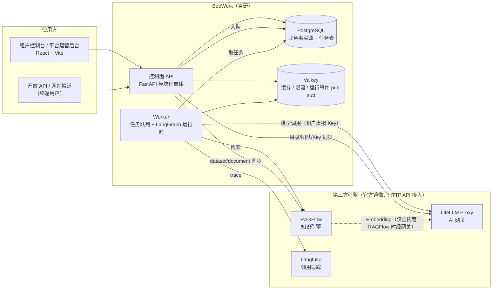

# BeeWork 架构与工程规范

> 读者：参与开发的工程师和编码模型。本文件是**怎么写代码**的约定；**做什么、先做什么**见 [`technical-plan.md`](./technical-plan.md) 与 [`tasks/README.md`](./tasks/README.md)；**做到哪了**见 [`development-status.md`](./development-status.md)。与本文件冲突的代码视为缺陷。

## 1. 系统全景



**核心原则**

1. **BeeWork 自研控制面与 LangGraph 运行时**；模型网关、知识解析检索、调用追踪用 LiteLLM / RAGFlow / Langfuse，只调用其 HTTP API，不读写其内部存储，不在 BeeWork 内重复实现其能力。
2. **PostgreSQL 是业务事实源**。引擎中的对象（LiteLLM deployment/team/key、RAGFlow dataset/document、Langfuse trace）都是 BeeWork 数据的投影，丢失后可以从 BeeWork 重建。
3. **租户隔离由 BeeWork 保证**。引擎都用平台服务账号访问；BeeWork 只把属于当前租户（及环境）的对象 ID 交给引擎。
4. **控制面不跑长任务**。模型调用、文档同步、用量汇总、Webhook、定时流转都进 Worker。
5. **线上只执行不可变的发布版本**；草稿与调试不影响线上。

## 2. 代码结构

```text
backend/
  src/beework/
    api/                 # HTTP 路由，按领域一个文件；__init__.py 统一挂载到 /api/v1
      common.py          # 跨领域工具：lock_tenant、当前用户响应、登录会话
    models/__init__.py   # 现有 ORM 模型（身份、租户、审计、模型目录等）
    models/<domain>.py   # 新领域的 ORM 模型；必须在 models/__init__.py 末尾注册导入
    schemas/__init__.py  # 现有 Pydantic 模型
    schemas/<domain>.py  # 新领域的请求/响应模型
    integrations/        # 第三方引擎客户端：litellm.py、ragflow.py、langfuse.py
    runtime/             # LangGraph 运行时（DSL、编译器、节点实现）
    worker/              # 任务队列与 Worker 入口（T-002 建立）
    <domain 服务>.py     # 领域服务，如 tenant_lifecycle.py、gateway_sync.py
    rbac.py auth.py tenant_access.py config.py db.py
  migrations/versions/   # Alembic，序号_简短名称，revision ID ≤ 32 字符
  tests/                 # unittest；PostgreSQL 专用测试用 TEST_DATABASE_URL 门控
frontend/src/
  App.tsx                # 租户控制台外壳与路由
  api.ts                 # apiRequest：Cookie 会话、CSRF、X-Tenant-ID
  types.ts constants.ts  # 现有共享类型/常量（不要再往里堆新领域）
  pages/<domain>/        # 每个领域的页面、组件、types.ts（领域私有类型）
  components/            # 跨领域通用组件
  i18n/                  # 中英文案字典（T-003 建立）
config/litellm/          # LiteLLM 配置（模型不写在这里，由 BeeWork 经 API 注册）
scripts/                 # test-postgres.sh、check_gateway_e2e.py 等
```

并行开发时最容易冲突的文件是 `models/__init__.py`、`api/__init__.py`、`App.tsx`、`rbac.py`。新领域代码放在自己的文件里，对这些共享文件只做“注册一行”的修改。

## 3. 后端约定

### 3.1 数据与迁移

- 主键 UUID；时间列 `DateTime(timezone=True)`；默认值用 `utc_now`。
- 所有租户业务表带 `tenant_id`（外键到 `tenants`，`index=True`）。有组织归属的资源带 `organization_id`，并用 `(organization_id, tenant_id)` 复合外键防跨租户引用（参考 `TenantRole`）。
- 可编辑资源带 `row_version`（int）。更新请求携带 `row_version`，不一致返回 409，提示“该对象已被 {姓名} 修改，请刷新后重试”（RUL-005）。
- 需要回收站语义的资源用 `deleted_at` 软删除；审计与工单记录不可删除。
- 迁移文件 `NNNN_short_name.py`，**revision ID 不超过 32 字符**；每个迁移必须能 `downgrade`；提交前运行 `./scripts/test-postgres.sh`（会做升级 → `alembic check` → 降级 → 再升级）。
- 不要修改已发布的迁移；schema 变化一律新增迁移。

### 3.2 API

- 路径前缀 `/api/v1`，平台后台接口在 `/api/v1/platform/*`，租户接口靠 `X-Tenant-ID` 选择租户。
- 写操作依赖 `require_csrf`。租户接口用 `require_tenant_permission("module:action")`；只有企业管理员能做的用 `require_tenant_roles("tenant_admin")`；平台接口用 `Depends(require_platform_admin)`（`api/conventions.py`），不要手写 `if not user.is_platform_admin`。
- **新增权限**：在 `rbac.PERMISSION_CATALOG` 加模块/动作，并按 PRD 6.1 配置五个内置角色；同时补测试证明无权角色得到 403。
- **资源级授权**：读写单个资源时调用 `ensure_resource_in_scope(membership, resource, db)`（租户不符或组织范围外一律 **404**，不泄露存在性）；列表查询用 `scope_filter(statement, Model, membership, db)` 追加组织范围过滤。只靠前端隐藏菜单不算授权。
- **公共约定都在 `beework.api.conventions`**，不要各模块自己再写一套：

| 约定 | 用法 |
|---|---|
| 错误 | `raise ApiError(409, "assistant.name_taken", "名称已存在")` → `{"detail": "...", "code": "assistant.name_taken"}`；旧 `HTTPException` 自动补 `code: "error"`；422 校验错误为 `{"detail": "字段：原因", "code": "validation.invalid", "errors": [...]}` |
| 分页 | `pagination: Pagination = Depends(get_pagination)`（limit 默认 20、≤100，offset ≥ 0）；`items, total = paginate(db, statement.order_by(...), pagination)`；响应 `Page[XResponse]` = `{items, total, limit, offset}`。**语句必须自带稳定排序** |
| 乐观锁 | 模型混入 `VersionedMixin`（`row_version`、`updated_by`）；更新请求带 `row_version`，先 `check_row_version(obj, payload.row_version, db)`（不一致 409 `conflict.stale`），写入后 `obj.row_version += 1; obj.updated_by = 姓名` |
| 通用列 | `TenantOwnedMixin`（`tenant_id` + 索引）、`TimestampMixin`、`SoftDeleteMixin` |
| 名称 | `name = normalize_name(payload.name, 80)`；`ensure_unique_name(db, Model, tenant_id, name, exclude_id)`（同租户不区分大小写，5.7） |
| 外部 URL | 用户可配置的出站地址在 schema 里用 `validate_public_https_url`（必须 https、含点主机名、解析结果不得为私网/回环/链路本地/保留地址，NFR-009）。单元测试不要依赖 DNS，调用 `tests/isolation.stub_public_dns()` |

- 列表分页：`?limit=20&offset=0`（limit ≤ 100），响应 `{"items": [...], "total": N, "limit": 20, "offset": 0}`。
- 状态变更遵守 PRD 第 5 章状态机；非法流转返回 409。
- 租户只读/停用状态由 `get_tenant_membership` 统一拦截写请求，新接口无需重复判断，但不能绕过它。

#### 新领域模块样板（以“笔记 note”为例，后续任务照抄并改名）

```python
# backend/src/beework/models/note.py —— 并在 models/__init__.py 末尾注册
class Note(TenantOwnedMixin, TimestampMixin, VersionedMixin, SoftDeleteMixin, Base):
    __tablename__ = "notes"
    id: Mapped[UUID] = mapped_column(Uuid(as_uuid=True), primary_key=True, default=uuid4)
    name: Mapped[str] = mapped_column(String(80), nullable=False)
    organization_id: Mapped[UUID | None] = mapped_column(Uuid(as_uuid=True), nullable=True)

# backend/src/beework/schemas/note.py
class NoteWriteRequest(BaseModel):
    name: str
    row_version: int | None = None          # 更新时必填

class NoteResponse(BaseModel):
    model_config = ConfigDict(from_attributes=True)
    id: UUID; name: str; row_version: int

# backend/src/beework/api/note.py —— 并在 api/__init__.py 注册
@router.get("/notes", response_model=Page[NoteResponse])
def list_notes(pagination: Pagination = Depends(get_pagination),
               membership: Membership = Depends(require_tenant_permission("note:read")),
               db: Session = Depends(get_db)):
    statement = select(Note).where(Note.tenant_id == membership.tenant_id, Note.deleted_at.is_(None))
    statement = scope_filter(statement, Note, membership, db).order_by(Note.created_at.desc(), Note.id)
    items, total = paginate(db, statement, pagination)
    return Page[NoteResponse](items=items, total=total, limit=pagination.limit, offset=pagination.offset)

@router.put("/notes/{note_id}", response_model=NoteResponse)
def update_note(note_id: UUID, payload: NoteWriteRequest,
                membership: Membership = Depends(require_tenant_permission("note:write")),
                _: None = Depends(require_csrf), db: Session = Depends(get_db)):
    note = db.get(Note, note_id)
    if note is None:
        raise ApiError(404, "not_found", "未找到指定资源")
    ensure_resource_in_scope(membership, note, db)       # 跨租户 / 范围外 → 404
    check_row_version(note, payload.row_version, db)      # 过期 → 409 conflict.stale
    name = normalize_name(payload.name, 80)
    ensure_unique_name(db, Note, membership.tenant_id, name, exclude_id=note.id)
    note.name, note.row_version, note.updated_by = name, note.row_version + 1, membership.user.name
    db.add(AuditEvent(tenant_id=membership.tenant_id, actor_user_id=membership.user_id,
                      action="note.update", details={"note_id": str(note.id)}))
    db.commit()
    return note
```

测试骨架（`backend/tests/test_note.py`）：每个写接口至少覆盖 ① 成功且写入审计；② 校验失败（空名称/重名 → 400/409）；③ 无权限角色 → 403；④ 跨租户或组织范围外 → 404；⑤ 过期 `row_version` → 409 `conflict.stale`；⑥ 列表 `limit=101` → 422、`offset` 超出 → 空 `items` 且 `total` 正确。参考 `tests/test_conventions.py` 与 `tests/test_tenant_auth.py` 的 SQLite 夹具。

### 3.3 审计

- PRD GLB-088：**所有写操作写审计**。`db.add(AuditEvent(tenant_id=..., actor_user_id=..., action="domain.verb", details={...}))`，与业务写入同一事务。
- 新动作在 `AUDIT_ACTION_DESCRIPTIONS` 增加中文描述；`details` 只放字符串，不放密钥和长正文。
- 平台对租户的操作同时写平台审计（`tenant_id=None`）和租户审计（参考 `platform_tenants._record_lifecycle_audit`）。
- 审计表是只追加的哈希链，数据库触发器禁止 UPDATE/DELETE；不要尝试修改审计记录。

### 3.4 并发

- 需要串行化租户级检查（席位、配额、生命周期）时用 `api.common.lock_tenant`（`SELECT ... FOR NO KEY UPDATE`）。**不要**对 `tenants` 用裸 `with_for_update()`，它会和写审计时的外键锁互相等待（已有测试复现）。
- 并发相关的保证必须有 PostgreSQL 测试（SQLite 不支持行锁和 advisory lock）。

### 3.5 密钥

- 上游/引擎凭证用 `model_secrets.encrypt_model_api_key` 加密存储，响应只返回掩码；日志、审计、错误信息里不得出现明文。
- 平台签发给客户的 API Key 只存哈希（SET-090）。

### 3.6 异步任务（T-002 建立后强制）

- 任务表在 PostgreSQL：业务写入与入队在**同一事务**（outbox），Worker 用 `FOR UPDATE SKIP LOCKED` 取任务。
- 每个任务有 `kind`、`payload`、`idempotency_key`、`attempts`、`run_after`、`last_error`；处理器必须幂等，失败按指数退避重试，界面能看到进度与失败原因（NFR-020）。
- 用法（`beework.worker`）：
  - 注册处理器：`@job_handler("domain.verb")`，签名 `(db, payload) -> None`，抛异常即失败重试（30s × 2^n，上限 1h），超过 `max_attempts`（默认 5）置 `dead`，平台后台“任务”页可见并可重试。
  - 入队：`enqueue(db, "domain.verb", {...}, tenant_id=..., idempotency_key="domain.verb:<业务键>")`，**只加入调用方的事务，由调用方提交**。相同 `idempotency_key` 返回已有任务（并发抢同一个键时输家在保存点内恢复，不会让整个事务失败）。
  - 定时任务：在 `worker/scheduler.py` 的 `enqueue_scheduled_jobs` 里按时间窗入队，键用 `kind:时间窗`。Worker 约每 60 秒检查一次。
  - Worker 主循环（`worker/runner.py`）不会因单次数据库异常退出，失败后退避重试；锁超过 15 分钟的 `running` 任务会被放回队列，所以**处理器必须幂等且单次不超过 15 分钟**。
- 运行事件实时推送：
  - 发布：`publish_run_event(db, run_id, type, data, tenant_id=...)` 先写 `run_events`（同一 run 内 `seq` 递增，PostgreSQL 用 advisory lock 串行）并提交，再 `PUBLISH run:{run_id}` 到 Valkey；Valkey 失败只记日志，事件不丢。
  - 订阅：`stream_run_events` 以数据库表为唯一内容来源，**先订阅 Valkey、再读历史**，Valkey 消息只用来提前唤醒，另有轮询兜底，因此不会出现“历史与实时之间的空洞”；遇到 `done` / `error` / `cancelled` 事件后结束。
  - 接口：`GET /api/v1/runs/{run_id}/events?after_seq=`（SSE，需要租户成员身份，`X-Tenant-ID`）。**运行不属于当前租户，或还没有任何事件，一律 404**；因此创建 run 的事务里必须同时发布第一个事件（`queued`）。T-025 起接口按 `runs` 表校验：run 必须属于当前租户且其助理对调用者可见（`assistants:view`），否则 404。

### 3.7 与第三方引擎同步

参考 `gateway_sync.py`：

1. 业务事务先提交；
2. 再调用引擎 API；
3. 结果写回该行的 `*_sync_status`（`not_configured` / `synced` / `failed`）和 `*_error`；
4. 提供“重试同步”接口；Worker 建立后（T-005），同步改为入队执行。

引擎未配置时功能降级为 `not_configured`，不能让控制面报 500。引擎客户端放在 `integrations/`，所有对外错误转换为中文、截断、不带密钥。

| BeeWork 对象 | 引擎对象 | 说明 |
|---|---|---|
| 平台模型目录项 | LiteLLM deployment，别名 `bw-{model_id}` | 停用即从网关删除 |
| 租户 × 环境 | LiteLLM team（`beework:{tenant}:{env}`）+ 虚拟 Key | team 只放行该环境启用的模型；Key 加密存于 `tenant_model_environments` |
| 用量/点数 | LiteLLM spend logs（按 team 汇总） | Worker 定期拉取汇总为点数（T-011） |
| 知识库 | RAGFlow dataset（普通库：文档 dataset + FAQ dataset；FAQ 库：仅 FAQ dataset） | `knowledge_bases.ragflow_dataset_id` / `ragflow_faq_dataset_id`；dataset 名用 `bw-{tenant}-{kb_id}` |
| 文档 | RAGFlow document | 上传后触发解析，Worker 轮询状态 |
| FAQ | FAQ dataset（`qa` 方法）中的问答对 | BeeWork 为事实源，只推送已发布 FAQ |
| 运行 run | Langfuse trace（`trace_id = run_id`） | 运营页按 run_id 跳转 |

### 3.8 LangGraph 运行时

- 助理/智能体配置以**版本化 JSON DSL** 保存（`dsl_version` 字段），发布时冻结为不可变快照；Worker 只执行快照。
- 编译器把 DSL 转成 `StateGraph`；节点只能是受控实现（LLM、知识检索、条件、变量、受信工具、人工审批、追问）。**禁止**在 DSL 中保存或执行任意代码。
- 模型调用：`langchain-openai` 的 `ChatOpenAI(base_url=LiteLLM/v1, api_key=租户环境虚拟 Key, model="bw-{model_id}")`，因此限流、权限和计费都在网关侧生效。
- 追踪：Langfuse Python SDK **v3 及以上**（基于 OpenTelemetry）的 LangChain `CallbackHandler`，trace 带 `tenant_id`、`assistant_id`、`version`、`run_id` 元数据，不上传未脱敏的敏感正文（按 SET-070）。
- **Langfuse Cloud 的旧接口将于 2026-11-16 下线**：旧版写入接口 `POST /api/public/ingestion`（只剩 score 事件）和 `GET /api/public/traces/*`（已返回 410）都不能用。写入只走 OpenTelemetry（`/api/public/otel/v1/traces`，SDK v3 默认如此），读取只用 `GET /api/public/v2/observations` 与 `/api/public/v2/metrics`。旧版 SDK（v2）和 LiteLLM 的 `langfuse` 回调都依赖旧接口，禁止使用；LiteLLM 侧用 `langfuse_otel` 回调。
- **运行入口与执行**：`POST /assistants/{id}/runs`（`assistants:test`）建 `runs` 行（冻结 `AssistantDSLv1` 快照）、入队 `runtime.execute` 并在同一事务发布 `queued` 事件；Worker 的 `runtime/executor.py` 执行，事件依次为 `queued → running → step* / token* → done | error | cancelled`；取消用 `POST /runs/{id}/cancel`。图是固定管线 `input_guard → retrieve → generate → output`，节点只能来自 `runtime/compiler.py` 的 `NODE_FACTORIES`。
- **检索接缝**：运行时只依赖 `runtime/retrieval.py` 的 `Retriever` 协议；目前只有 `StubRetriever`（`mode="stub"`，不访问任何后端），所有事件、run 记录里都带 `retrieval.mode`，界面必须标注“未接真实 RAGFlow”。T-033 用真实实现替换。
- **Langfuse**：SDK 版本锁定 `langfuse==3.15.0`（需要 `langchain`）；Langfuse Cloud 要求 span 带请求头 `x-langfuse-ingestion-version: 4`，否则 `GET /api/public/v2/observations` 读不到；读取时要加 `fields=core,basic,io,metadata` 才返回 metadata。trace id 由 `run_id` 派生（`Langfuse.create_trace_id(seed=run_id)`）。
- **Worker 与 API 共用配置**：Worker 需要 `MODEL_CREDENTIALS_SECRET`、`LITELLM_*`、`LANGFUSE_*` 环境变量（compose 已配置），因为它要解密租户环境的网关 Key 并调用模型。
- 需要中断/恢复的图（Chatflow 追问、人工审批）使用 PostgreSQL checkpointer，与业务库同实例、独立 schema。

## 4. 前端约定

- 新领域在 `src/pages/<domain>/` 下组织页面与私有类型；路由在 `App.tsx` 中只加一行 `<Route>`。
- 调用后端一律用 `apiRequest(path, options, tenantId)`；不要自己拼 CSRF 或租户头。
- 每个页面都要有加载、空、失败、无权限四种状态；写操作按钮提交中禁用（GLB-040）；危险操作用自定义确认弹窗，不用 `window.confirm`（GLB-044）。
- 权限：菜单与按钮按 `/auth/me` 返回的 `permissions` 显示或隐藏（PER-003），租户 `access_mode === 'read_only'` 时隐藏所有写操作。
- 文案：所有新文案走 i18n 字典（`i18next` + `react-i18next`），中文默认、英文必填，不要在组件里写死中文，也不要新增 `constants.ts` 之类的文案常量文件。**如何新增文案**：
  1. 在 `frontend/src/i18n/zh-CN/<ns>.json` 与 `frontend/src/i18n/en/<ns>.json` 同时加同名 key（命名空间：`common`、`nav`、`auth`、`members`、`platform`、`settings`、`audit`、`enums`；新领域可新建同名文件并在 `i18n/index.ts` 的 `resources`/`ns` 中注册）。
  2. 组件内用 `const { t } = useTranslation('<ns>')`，再 `t('key')`；带变量写 `t('key', { name })`，字典里用 `{{name}}`；换行用 `\n` 并在组件里拆分渲染。
  3. 后端枚举/状态值（租户状态、套餐、区域、角色、模型类型、网关同步状态等）统一放 `enums` 命名空间，用 `enumLabel('group', value)` 取文案、`enumOptions('group')` 生成下拉；未知值原样显示。
  4. 时间与数字用 `i18n/format.ts`：`formatRelativeTime`（列表）、`formatDateTime(value, tenantTimeZone)`（详情）、`formatCompactNumber`（`18.2k`/`2.48M`）、`formatPercent`（1 位小数）。
  5. 提交前运行 `npm run i18n:check`（CI 也会跑）：两种语言的命名空间与 key 必须完全一致。
  6. 语言来源：用户偏好（`/auth/me` 的 `locale`，`PATCH /auth/me/preferences` 保存）→ 浏览器 `localStorage`（`beework.locale`）→ `zh-CN`。后端错误信息暂不翻译，后续按 `code` 映射。
- 视觉：沿用现有深绿/暖金/浅色工作区风格和 `App.css` 中的类名；新增样式放在文件末尾并以领域前缀命名。
- 不在浏览器保存业务状态；`localStorage` 只用于当前租户选择等偏好。

## 5. 测试与完成定义

一个任务只有同时满足以下条件才算完成：

1. 数据模型、迁移、API、权限、审计、界面都已实现，**不是 mock 或占位**；
2. 后端测试覆盖：成功路径、校验失败、无权限 403、跨租户访问被拒绝、状态机非法流转；并发相关的有 PostgreSQL 测试；
3. 依赖第三方引擎的功能，客户端有契约测试（`httpx.MockTransport`），并在任务记录中写明是否连过真实引擎；
4. 以下检查全部通过：
   ```bash
   (cd backend && uvx ruff@0.14.0 check .)
   ./scripts/test-postgres.sh
   docker compose exec web sh -c "npx tsc -b && npm run lint && npm run build"
   ```
5. 更新 `docs/tasks/README.md` 中的任务状态，在 `docs/development-status.md` 记录完成内容、验证结果和遗留问题。

## 6. 安全底线

- 不提交任何真实密钥；`.env` 不入库。
- 用户可控的 URL（模型接口、MCP、API 插件、Webhook、文档 URL）必须是 HTTPS 且禁止内网地址（NFR-009，统一 SSRF 校验由 T-001 提供）。
- 上传文件校验类型与大小后再转交 RAGFlow。
- 渲染用户内容一律走 React 转义，不使用 `dangerouslySetInnerHTML`。
