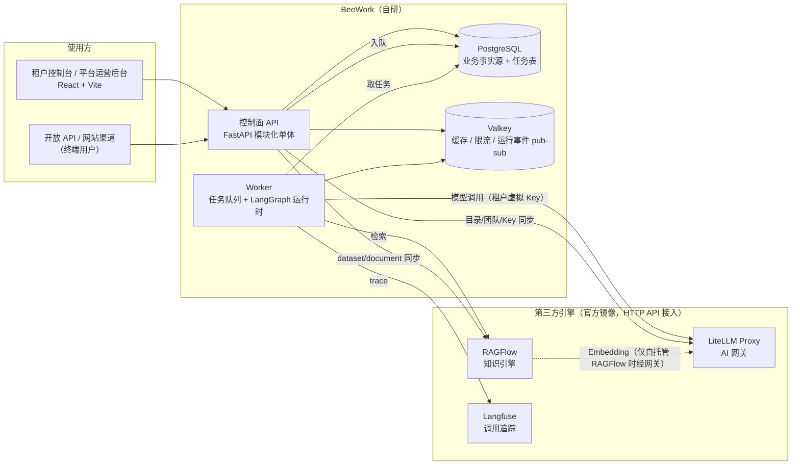

# BeeWork 架构与工程规范

> 读者：参与开发的工程师和编码模型。本文件是**怎么写代码**的约定；**做什么、先做什么**见 [`technical-plan.md`](./technical-plan.md) 与 [`tasks/README.md`](./tasks/README.md)；**做到哪了**见 [`development-status.md`](./development-status.md)。与本文件冲突的代码视为缺陷。

## 1. 系统全景



**核心原则**

1. **BeeWork 自研控制面与 LangGraph 运行时**；模型网关、知识解析检索、调用追踪用 LiteLLM / RAGFlow / Langfuse，只调用其 HTTP API，不读写其内部存储，不在 BeeWork 内重复实现其能力。
2. **PostgreSQL 是业务事实源**。引擎中的对象（LiteLLM deployment/team/key、RAGFlow dataset/document、Langfuse trace）都是 BeeWork 数据的投影，丢失后可以从 BeeWork 重建。
3. **租户隔离由 BeeWork 保证**。引擎都用平台服务账号访问；BeeWork 只把属于当前租户（及环境）的对象 ID 交给引擎。
4. **控制面不跑长任务**。模型调用、文档同步、用量汇总、Webhook、定时流转都进 Worker。
5. **线上只执行不可变的发布版本**；草稿与调试不影响线上。

## 2. 代码结构

```text
backend/
  src/beework/
    api/                 # HTTP 路由，按领域一个文件；__init__.py 统一挂载到 /api/v1
      common.py          # 跨领域工具：lock_tenant、当前用户响应、登录会话
    models/__init__.py   # 现有 ORM 模型（身份、租户、审计、模型目录等）
    models/<domain>.py   # 新领域的 ORM 模型；必须在 models/__init__.py 末尾注册导入
    schemas/__init__.py  # 现有 Pydantic 模型
    schemas/<domain>.py  # 新领域的请求/响应模型
    integrations/        # 第三方引擎客户端：litellm.py、ragflow.py、langfuse.py
    runtime/             # LangGraph 运行时（DSL、编译器、节点实现）
    worker/              # 任务队列与 Worker 入口（T-002 建立）
    <domain 服务>.py     # 领域服务，如 tenant_lifecycle.py、gateway_sync.py
    rbac.py auth.py tenant_access.py config.py db.py
  migrations/versions/   # Alembic，序号_简短名称，revision ID ≤ 32 字符
  tests/                 # unittest；PostgreSQL 专用测试用 TEST_DATABASE_URL 门控
frontend/src/
  App.tsx                # 租户控制台外壳与路由
  api.ts                 # apiRequest：Cookie 会话、CSRF、X-Tenant-ID
  types.ts constants.ts  # 现有共享类型/常量（不要再往里堆新领域）
  pages/<domain>/        # 每个领域的页面、组件、types.ts（领域私有类型）
  components/            # 跨领域通用组件
  i18n/                  # 中英文案字典（T-003 建立）
config/litellm/          # LiteLLM 配置（模型不写在这里，由 BeeWork 经 API 注册）
scripts/                 # test-postgres.sh、check_gateway_e2e.py 等
```

并行开发时最容易冲突的文件是 `models/__init__.py`、`api/__init__.py`、`App.tsx`、`rbac.py`。新领域代码放在自己的文件里，对这些共享文件只做“注册一行”的修改。

## 3. 后端约定

### 3.1 数据与迁移

- 主键 UUID；时间列 `DateTime(timezone=True)`；默认值用 `utc_now`。
- 所有租户业务表带 `tenant_id`（外键到 `tenants`，`index=True`）。有组织归属的资源带 `organization_id`，并用 `(organization_id, tenant_id)` 复合外键防跨租户引用（参考 `TenantRole`）。
- 可编辑资源带 `row_version`（int）。更新请求携带 `row_version`，不一致返回 409，提示“该对象已被 {姓名} 修改，请刷新后重试”（RUL-005）。
- 需要回收站语义的资源用 `deleted_at` 软删除；审计与工单记录不可删除。
- 迁移文件 `NNNN_short_name.py`，**revision ID 不超过 32 字符**；每个迁移必须能 `downgrade`；提交前运行 `./scripts/test-postgres.sh`（会做升级 → `alembic check` → 降级 → 再升级）。
- 不要修改已发布的迁移；schema 变化一律新增迁移。

### 3.2 API

- 路径前缀 `/api/v1`，平台后台接口在 `/api/v1/platform/*`，租户接口靠 `X-Tenant-ID` 选择租户。
- 写操作依赖 `require_csrf`。租户接口用 `require_tenant_permission("module:action")`；只有企业管理员能做的用 `require_tenant_roles("tenant_admin")`；平台接口检查 `user.is_platform_admin`。
- **新增权限**：在 `rbac.PERMISSION_CATALOG` 加模块/动作，并按 PRD 6.1 配置五个内置角色；同时补测试证明无权角色得到 403。
- **资源级授权**：读写单个资源时必须同时校验 `tenant_id` 与组织/助理范围（`rbac.ensure_organization_scope`）；查询列表时按范围过滤。只靠前端隐藏菜单不算授权。
- 错误响应：`{"detail": "给用户看的中文信息", "code": "domain.reason"}`（由 T-001 的 `ApiError` 统一实现；在它合入前，新代码先保证 `detail` 可读）。
- 列表分页：`?limit=20&offset=0`（limit ≤ 100），响应 `{"items": [...], "total": N, "limit": 20, "offset": 0}`。
- 状态变更遵守 PRD 第 5 章状态机；非法流转返回 409。
- 租户只读/停用状态由 `get_tenant_membership` 统一拦截写请求，新接口无需重复判断，但不能绕过它。

### 3.3 审计

- PRD GLB-088：**所有写操作写审计**。`db.add(AuditEvent(tenant_id=..., actor_user_id=..., action="domain.verb", details={...}))`，与业务写入同一事务。
- 新动作在 `AUDIT_ACTION_DESCRIPTIONS` 增加中文描述；`details` 只放字符串，不放密钥和长正文。
- 平台对租户的操作同时写平台审计（`tenant_id=None`）和租户审计（参考 `platform_tenants._record_lifecycle_audit`）。
- 审计表是只追加的哈希链，数据库触发器禁止 UPDATE/DELETE；不要尝试修改审计记录。

### 3.4 并发

- 需要串行化租户级检查（席位、配额、生命周期）时用 `api.common.lock_tenant`（`SELECT ... FOR NO KEY UPDATE`）。**不要**对 `tenants` 用裸 `with_for_update()`，它会和写审计时的外键锁互相等待（已有测试复现）。
- 并发相关的保证必须有 PostgreSQL 测试（SQLite 不支持行锁和 advisory lock）。

### 3.5 密钥

- 上游/引擎凭证用 `model_secrets.encrypt_model_api_key` 加密存储，响应只返回掩码；日志、审计、错误信息里不得出现明文。
- 平台签发给客户的 API Key 只存哈希（SET-090）。

### 3.6 异步任务（T-002 建立后强制）

- 任务表在 PostgreSQL：业务写入与入队在**同一事务**（outbox），Worker 用 `FOR UPDATE SKIP LOCKED` 取任务。
- 每个任务有 `kind`、`payload`、`idempotency_key`、`attempts`、`run_after`、`last_error`；处理器必须幂等，失败按指数退避重试，界面能看到进度与失败原因（NFR-020）。
- 运行事件实时推送：事件持久化到 `run_events`，同时发布到 Valkey 频道 `run:{run_id}`；SSE 接口先回放数据库中的事件，再订阅频道。

### 3.7 与第三方引擎同步

参考 `gateway_sync.py`：

1. 业务事务先提交；
2. 再调用引擎 API；
3. 结果写回该行的 `*_sync_status`（`not_configured` / `synced` / `failed`）和 `*_error`；
4. 提供“重试同步”接口；Worker 建立后（T-005），同步改为入队执行。

引擎未配置时功能降级为 `not_configured`，不能让控制面报 500。引擎客户端放在 `integrations/`，所有对外错误转换为中文、截断、不带密钥。

| BeeWork 对象 | 引擎对象 | 说明 |
|---|---|---|
| 平台模型目录项 | LiteLLM deployment，别名 `bw-{model_id}` | 停用即从网关删除 |
| 租户 × 环境 | LiteLLM team（`beework:{tenant}:{env}`）+ 虚拟 Key | team 只放行该环境启用的模型；Key 加密存于 `tenant_model_environments` |
| 用量/点数 | LiteLLM spend logs（按 team 汇总） | Worker 定期拉取汇总为点数（T-011） |
| 知识库 | RAGFlow dataset（普通库：文档 dataset + FAQ dataset；FAQ 库：仅 FAQ dataset） | `knowledge_bases.ragflow_dataset_id` / `ragflow_faq_dataset_id`；dataset 名用 `bw-{tenant}-{kb_id}` |
| 文档 | RAGFlow document | 上传后触发解析，Worker 轮询状态 |
| FAQ | FAQ dataset（`qa` 方法）中的问答对 | BeeWork 为事实源，只推送已发布 FAQ |
| 运行 run | Langfuse trace（`trace_id = run_id`） | 运营页按 run_id 跳转 |

### 3.8 LangGraph 运行时

- 助理/智能体配置以**版本化 JSON DSL** 保存（`dsl_version` 字段），发布时冻结为不可变快照；Worker 只执行快照。
- 编译器把 DSL 转成 `StateGraph`；节点只能是受控实现（LLM、知识检索、条件、变量、受信工具、人工审批、追问）。**禁止**在 DSL 中保存或执行任意代码。
- 模型调用：`langchain-openai` 的 `ChatOpenAI(base_url=LiteLLM/v1, api_key=租户环境虚拟 Key, model="bw-{model_id}")`，因此限流、权限和计费都在网关侧生效。
- 追踪：Langfuse 的 LangChain `CallbackHandler`，trace 带 `tenant_id`、`assistant_id`、`version`、`run_id` 元数据，不上传未脱敏的敏感正文（按 SET-070）。
- 需要中断/恢复的图（Chatflow 追问、人工审批）使用 PostgreSQL checkpointer，与业务库同实例、独立 schema。

## 4. 前端约定

- 新领域在 `src/pages/<domain>/` 下组织页面与私有类型；路由在 `App.tsx` 中只加一行 `<Route>`。
- 调用后端一律用 `apiRequest(path, options, tenantId)`；不要自己拼 CSRF 或租户头。
- 每个页面都要有加载、空、失败、无权限四种状态；写操作按钮提交中禁用（GLB-040）；危险操作用自定义确认弹窗，不用 `window.confirm`（GLB-044）。
- 权限：菜单与按钮按 `/auth/me` 返回的 `permissions` 显示或隐藏（PER-003），租户 `access_mode === 'read_only'` 时隐藏所有写操作。
- 文案：T-003 完成后所有新文案走 i18n 字典（中文默认、英文必填）；在那之前写中文，但不要把文案散落在多个常量文件。
- 视觉：沿用现有深绿/暖金/浅色工作区风格和 `App.css` 中的类名；新增样式放在文件末尾并以领域前缀命名。
- 不在浏览器保存业务状态；`localStorage` 只用于当前租户选择等偏好。

## 5. 测试与完成定义

一个任务只有同时满足以下条件才算完成：

1. 数据模型、迁移、API、权限、审计、界面都已实现，**不是 mock 或占位**；
2. 后端测试覆盖：成功路径、校验失败、无权限 403、跨租户访问被拒绝、状态机非法流转；并发相关的有 PostgreSQL 测试；
3. 依赖第三方引擎的功能，客户端有契约测试（`httpx.MockTransport`），并在任务记录中写明是否连过真实引擎；
4. 以下检查全部通过：
   ```bash
   (cd backend && uvx ruff@0.14.0 check .)
   ./scripts/test-postgres.sh
   docker compose exec web sh -c "npx tsc -b && npm run lint && npm run build"
   ```
5. 更新 `docs/tasks/README.md` 中的任务状态，在 `docs/development-status.md` 记录完成内容、验证结果和遗留问题。

## 6. 安全底线

- 不提交任何真实密钥；`.env` 不入库。
- 用户可控的 URL（模型接口、MCP、API 插件、Webhook、文档 URL）必须是 HTTPS 且禁止内网地址（NFR-009，统一 SSRF 校验由 T-001 提供）。
- 上传文件校验类型与大小后再转交 RAGFlow。
- 渲染用户内容一律走 React 转义，不使用 `dangerouslySetInnerHTML`。
